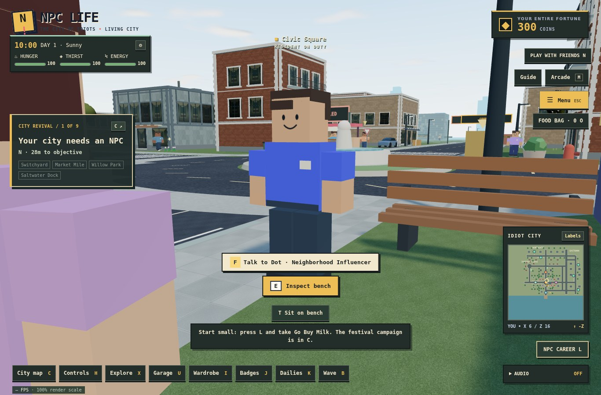
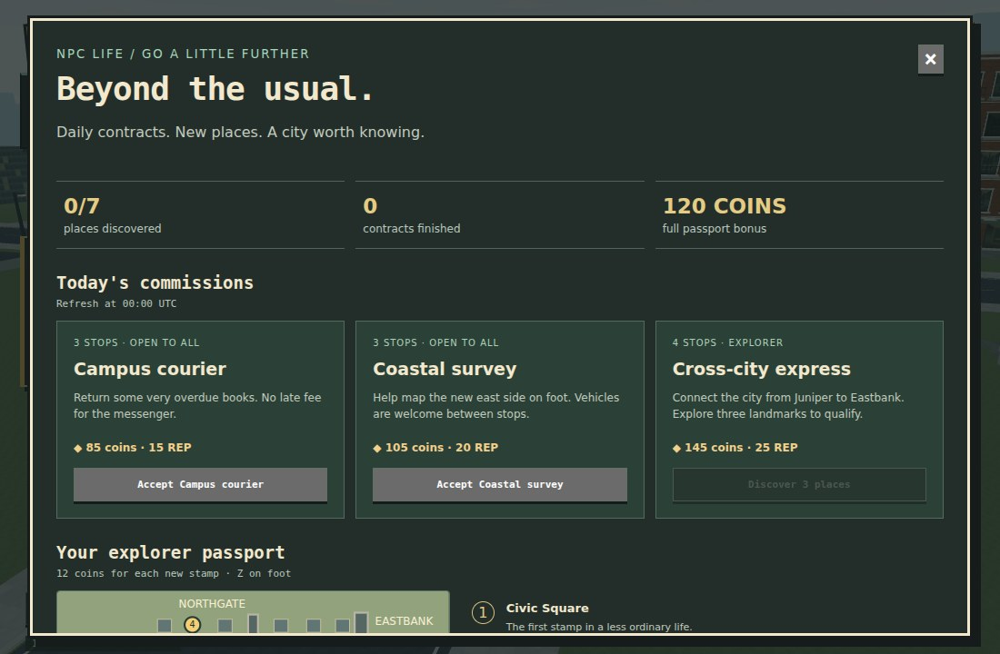

# Blocky residents, a bigger city, and a lighter renderer

Branch: `feat/blocky-explorers-performance`, based on verified cinematic-art commit `456f568d7a7a415706994744d2524d25594c6b55`. This branch includes the previous vehicle, physics, weather, economy and career work. It does not merge or replace `main`.

## Play the update

- **X / Explore** opens daily contracts and the explorer passport. **Z** handles the current stop or stamps a landmark, on foot. You may drive between stops. Accepting a resident shift and a daily contract at the same time is prevented.
- Seven original commissions rotate into three daily offers at **00:00 UTC**. Three-stop commissions pay 85–105 existing coins and 15–20 reputation; longer four-stop commissions require three discoveries and pay 145 coins / 25 reputation. Each offer pays once per day. Accepted routes survive reload and midnight; cancelling pays nothing.
- Discover seven landmarks for 12 coins and 3 reputation each. Completing the passport awards another 120 coins / 30 reputation and the City Explorer passport badge. These rewards use the existing wallet; premium vehicles retain their career gates.
- The extra feature is **discovery-unlocked free shuttles**. Once visited, Civic Square, Juniper, Northgate and Eastbank become stations in the passport. Travel from a discovered station after finishing work and exiting your vehicle. This makes revisiting the larger world convenient while retaining the first journey.
- **U** still opens the original 30-vehicle dealership. Northgate and Eastbank add collection desks and collision-checked bays, bringing the total to four garages. All 30 models have valid collection and exit positions at every garage.
- The clock gear exposes graphics quality, adaptive resolution, the FPS/scale display and a separate cinematic-effects switch. Medium and adaptive resolution are the defaults; expensive AO/bloom now require explicit opt-in on High.

## World and characters

The world bounds increase from ±136 to ±210 meters. Roads connect the existing city to Northgate Campus and Eastbank, with the observatory, solar gardens and coastal lookout as new destinations. The southern seawall remains the same. The expansion includes buildings, paths, original landmark models, lighting, residents, marked discovery points, map labels and garage bays; it is not just an enlarged empty boundary.

Player, pedestrian, shopkeeper and remote-player rigs share an original block-avatar design: cuboid body and limbs, simple friendly face, hair silhouettes and clothing colors. Shoulder clearance and pedestrian personal space are adjusted to match the wider block bodies. The moving rig uses seven meshes and fewer than 260 triangles, including the face. Existing limb refs, facing direction, foot height, wardrobe colors and motorcycle poses remain compatible. No Roblox models, branding or proprietary reference assets are included.

## Rendering changes

- Vertex-colored merged avatar parts replace dozens of individual face/body meshes.
- Tree instances are partitioned into spatial cells. Nearby trees use 16/28/40 leaf cards per tree on Low/Medium/High, versus 84 previously; distant trees use inexpensive opaque canopies. Leaf cards no longer enter the shadow pass.
- Architecture is batched by material within spatial cells. Distant blocks use simplified textured shells; wall geometry casts building shadows instead of every individual sill and railing.
- Detailed vehicles switch to their existing simplified model at 38 meters. The dealership renders on demand and still supports dragging with damped orbit controls.
- The sky uses fewer noise octaves, and the far skyline sits beyond the expanded playable districts. Medium visibility is bounded to avoid rendering an unnecessarily distant scene.
- Shadow maps update at up to 20 Hz on Medium / 30 Hz on High. Simulation and input rates are unchanged. Hidden browser tabs stop their render loop; room networking remains active.
- Adaptive resolution uses sustained frame-time samples and slow recovery, bounded between 0.65 and the preset/device cap. It never alters the fixed physics step or saves a temporary low scale as the user's quality choice.
- Static collisions use a 16-meter spatial broadphase with precomputed rotations. An 18,000-position comparison checks the exact same narrow-phase results, including rotated footprints and large vehicle radii.

### Reproducible render comparison

`npm run test:performance` runs three fixed views at 1100×720, DPR 1, Medium, with adaptive resolution disabled and all shadow updates forced on for comparison. It records draw calls and triangles including shadows, checks context health, and enforces conservative scene budgets. The previous branch is measured with the same harness in a separate checkout. Figures below are measurements of scene work, not guaranteed hardware FPS; software-WebGL wall times vary substantially and are not used as performance claims.

| Fixed view | Draws before → after | Triangles before → after |
| --- | ---: | ---: |
| Civic | 944 → 537 (−43%) | 438,645 → 174,653 (−60%) |
| Avenue | 1,467 → 860 (−41%) | 471,744 → 233,314 (−51%) |
| North | 306 → 279 (−9%) | 300,612 → 131,206 (−56%) |

The requested i5-11th-gen / RTX 3050 system was not available here. Hardware-specific frame pacing still needs confirmation on that computer. The new FPS/scale display makes the current behavior visible without developer tools.

## Saves and multiplayer

Existing save keys, purchases, career chapters, missions, needs and weather remain intact. A new validated `npc-life:exploration-v1` record stores stamps, daily claims and an in-progress route, and participates in backup import/export and rollback. Older backups start with an empty new passport; they do not inherit unrelated passport progress. Previous High quality saves keep High shadows but default the new expensive cinematic toggle to off.

Rooms use the expanded shared world geometry and unchanged authentication, ownership and server simulation. Exploration rewards and the personal garage remain browser-local, like the existing economy. Personal collection is still solo-only; local garage unlocks do not authorize shared vehicle spawning.

## Verification

- 78 automated tests: world placement/reachability, broadphase equivalence, avatar geometry, all garage/model combinations, fixed-step physics, wet braking, motorcycle balancing, contracts, rollover, reward deduplication, save migration/import and room boundaries/authentication.
- Production TypeScript/Vite build.
- 10 exploration browser checks: actual keyboard travel across the former boundary, real block rigs, route reload, shift exclusion, one-time rewards, all seven discoveries, unlocked shuttle travel, new-garage purchase/driving/exit, responsive dialogs, graphics toggles, and persistence.
- 11 existing mobility browser checks: purchases, all representative vehicle silhouettes, motorcycle driving, safe exits, paint/rim reload, responsive dealership UI and two-client server-authoritative motorcycle replication.
- Final renderer budget checks, visible desktop explorer UI, real showroom pointer drag and return to demand-render idle.

Browser fixtures use the existing relocation event to reach isolated interaction sites; the old-boundary traversal and vehicle driving use actual keyboard controls. Browser checks run in Chromium with software WebGL. Images in this document are captures of the running game.

## Continuing work

This is a complete playable milestone for characters, expansion, engagement and rendering cost. The broader overhaul still has room for authored interiors, a larger story/career campaign, more local activities, traffic routes within the new districts, fully dynamic rigid-body interactions, server-backed personal purchases, and hardware profiling across devices. It does not claim photorealism or a complete rigid-body engine.

