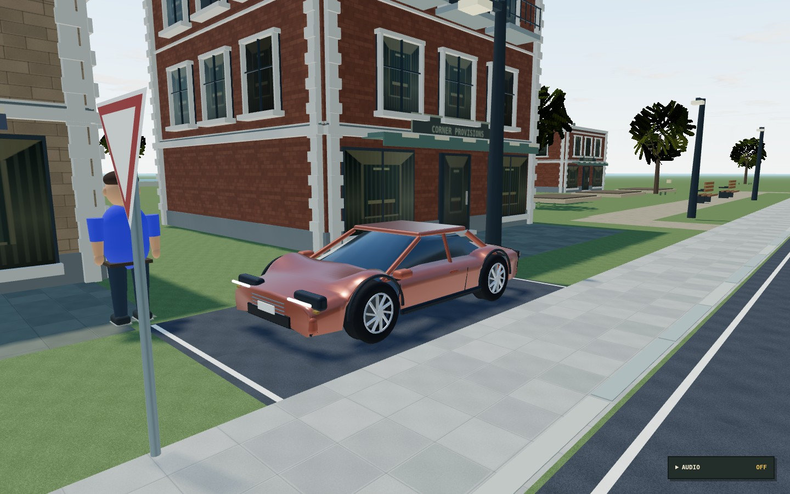
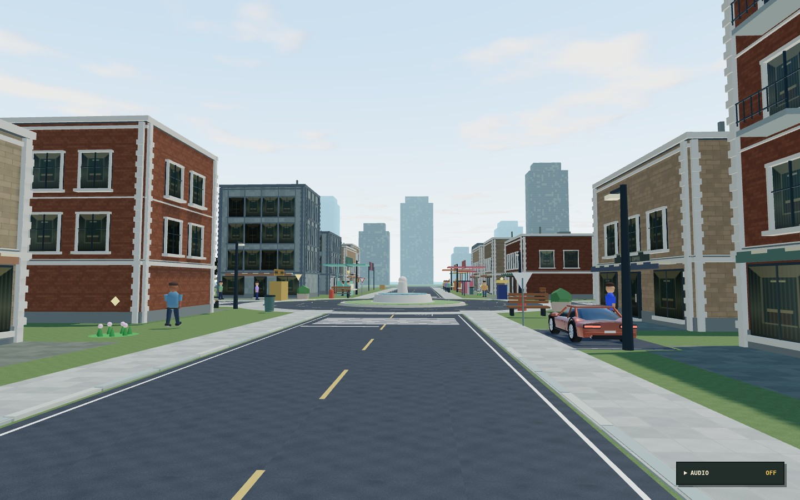

# Cinematic city art — 13 October 2026

Branch: `feat/cinematic-city-art`, based on the verified `feat/terrain-responsive-suspension` commit `2c466f6eacf6db934064e2a7e46b6e8b4eab9446`. This is a substantial original procedural art milestone. It does not complete a photorealistic asset library or the remaining physics/networking work.

## What changed

- All 23 four-wheel models use continuous curved body shells, open wheel arches, sloped glass, window pillars, mirrors, panel seams, grilles, bumpers, thin lights, exhausts, brake discs and multi-spoke rims. Vehicle dimensions and categories still come from the shared 30-model catalog. Premium paint uses clearcoat and environment reflections; pickups, utilities, buses, roadsters and performance models retain category-specific silhouettes. Seven motorcycles retain their working controller and suspension, with smoother tanks/fairings, frame tubes, exhausts and helmeted riders.
- The dealership now shows the actual driveable model in a rotatable studio preview, including premium vehicles before they are unlocked. Inspecting a card brings its preview into view. Existing ownership, pricing, paint, rims, reputation and career gates are unchanged.
- Fixed a rendering defect that placed full-width sidewalk rectangles above the asphalt. Asphalt and raised paving now occupy separate areas. Batched geometry supplies textured road surfaces, curb-side paving, edge lines, lane dashes, crossings, stop bars, parking and paths. Building frontage paving connects entrances with their surroundings. Original procedural albedo, bump and roughness textures supply asphalt aggregate, paving joints, brick, masonry, concrete, grass and bark.
- Modular facades now have recessed windows, mapped interior detail, mullions, sills, cornices, parapets, balconies, shop awnings, rooftop equipment and distinct brick/stone/glass finishes. The distant skyline has ground beneath it. Yield signs use a conventional triangular silhouette. Building footprints and all gameplay destinations remain the same.
- Instanced trunks/branches and alpha-cut leaf sprays replace solid geometric canopy balls. Character silhouettes, shoes, faces and nose orientation received a smaller polish; existing rigs, animations, interactions and outfits remain compatible.
- Atmospheric scattering, animated cloud density, weather tint and stars replace the old oval cloud meshes. A periodically refreshed environment probe gives cars, windows and wet roads reflections. Daylight exposure, sun/sky balance, fog and shadow bias were retuned together. Night windows remain emissive; a small pool of nearby streetlights lights the ground and characters. The driven vehicle has two actual forward spotlights at night and in heavy rain. Existing rain, lightning and ground splashes remain.
- The walking camera starts closer to street level. Driving camera and control logic are preserved.

All added art is original code/Canvas-generated content. The atmospheric sky, studio environment, rounded geometry and effects use the existing MIT-licensed Three.js package. No paid assets, branded vehicle models, external textures or new application dependencies are introduced.

## Rendering controls and cost

Open the living-city settings gear and choose **Graphics quality**. Low disables sun shadows, reduces rain and omits the streetlight pool. Medium uses a 1024-pixel nearby sun shadow and up to three local streetlights. High uses a 2048-pixel shadow, up to five streetlights, reduced-resolution screen-space ambient occlusion and restrained bloom. Headlights are reserved for the locally driven vehicle. These lights are hidden when unused.

Building details, tree branches and foliage are instanced; streets are combined by surface type; static vehicle bodywork is combined by material; wheel/body geometries and generated textures are reused. Vehicles beyond 55 metres switch to a two/three-mesh silhouette with simplified wheels. Reflection probes update on coarse weather/time changes rather than every frame. Medium remains the default. High costs additional full-screen passes and should be selected according to the player's hardware.

The browser QA runs use software WebGL. Their screenshots and scene statistics establish rendering correctness, not an FPS target or a hardware benchmark. Draw calls vary by camera position, shadow coverage, lights and quality. The Vite large-chunk warning remains; model/texture batching does not solve JavaScript code-splitting.

## Compatibility

No save keys, wallet rules, vehicle identifiers, mission coordinates, collision footprints, job rewards, network messages or authority boundaries changed. Suspension, fixed-timestep movement, wet-road handling, safe spawning and exclusive room ownership come from the previous verified milestones. Purchased vehicles and finishes remain in the existing garage save. Personal collection remains solo-only; shared rooms continue using the server-owned public fleet rather than trusting local unlocks.

## Verification

Use the optional Playwright/Chromium setup described in [development.md](development.md). Each browser suite creates an isolated profile. Run browser suites sequentially, because they share Vite's dependency cache.

```bash
npm test
npm run build
npm run test:suspension
npm run test:mobility
npm run test:foundation
npm run test:art
```

The art tests check that paving cannot conceal road-center samples, all car bodies have finite geometry and real wheel-arch clearance, and wheel radii still agree with suspension geometry. The art browser suite captures the actual city, close-up car, streets, sky, premium showroom, rain, night and high preset; it checks environment/material states, LOD switching, actual preview dragging, night headlights and live quality changes, and reports shader/runtime errors. The existing suspension, mobility and resident suites exercise actual vehicle/character models, purchases and saves, motorcycle controls, multiplayer ownership, jobs and responsive menus.

The two-client mobility fixture uses low graphics and alternates active rendering between its two connected clients on the software GPU. Both network sessions remain live. After driving and braking in the owner client, it resumes the guest renderer and checks that the remote motorcycle reaches the same world position. This verifies replication without claiming simultaneous hardware rendering performance. `NPC_MOBILITY_ONLY_NETWORK=1 npm run test:mobility` runs just that focused scenario; the normal command includes purchases and all other solo scenarios first.

Observed for this milestone:

- **68/68 Node tests passed**, including collision, wet braking, save migration, all catalog classes, room ownership, suspension and the three new rendering-geometry checks.
- TypeScript and the production build passed: approximately **1,446 kB JavaScript / 417 kB gzip**. The existing large-chunk warning remains.
- **Nine solo mobility browser checks passed**: purchases, duplicate-debit prevention, saved finishes, scooter controls, player landing, car entry/exit, premium/utility/bike models and responsive garage bounds.
- **Two focused multiplayer browser checks passed** using the low/alternating-render fixture described above. The initial simultaneous software-rendering attempts timed out; the successful focused run also verifies the guest's actual vehicle mesh position, not just room membership.
- **Four suspension browser checks passed** with the final models: sedan, scooter and bus contact/body response, plus no uncaught fixture errors.
- The art browser suite passed daytime/street captures, near/far vehicle detail, pointer-driven showroom inspection, night sky/headlights, rain materials, high effects and repeated graphics switching. No shader or runtime errors were reported in those flows.
- `git diff --check` passed. Screenshots were inspected; sidewalk-over-asphalt layering, exposed rear lamps, preview scrolling, legacy oval clouds and missing skyline ground were corrected during review.

The resident/campaign full browser playthrough was not repeated in this art milestone; its automated reachability, job-state and save regressions are included in the 68 tests above. Earlier milestone browser reports remain historical.

## Still unfinished

- Full rigid-body impact impulses, airborne suspension, collision deformation and movable city props.
- Server-persisted accounts, wallet/garage authority, shared purchases and personal vehicle collection in rooms.
- Authored high-detail characters, full enterable building interiors, richer vehicle cabin interiors, and a complete distant-object LOD system.
- Hardware frame-rate targets, real-device audio listening, long sessions and sustained eight-player load testing.

This milestone intentionally preserves the verified gameplay architecture while replacing the most visibly primitive rendering systems. It has not been merged into `main` or deployed.

## In-engine captures

The screenshots below come from the actual browser build, with the camera placed at street level for art inspection.




