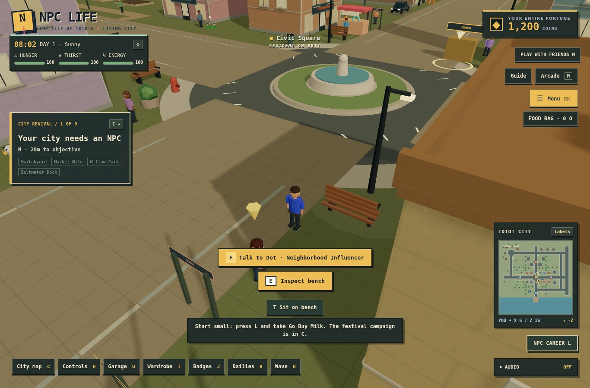
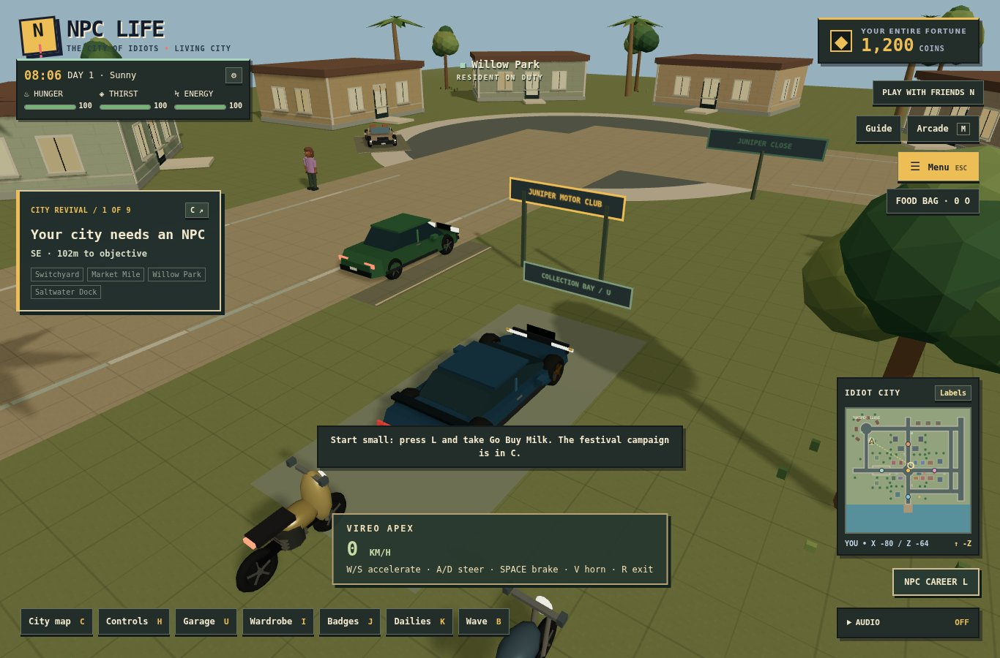
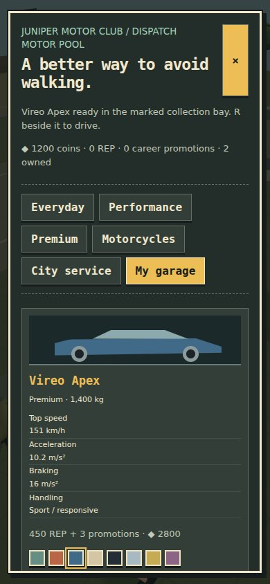

# City Mobility & Visual Foundation

This is a coherent first milestone of the requested visual/physics/vehicle overhaul, based on Living City commit `224c6a6eeb27c8d19d02431529da615506c32d95`. The Living City, career, campaign, food, weather, rooms, wardrobe and save systems remain in place.

The previously mentioned POLYGON reference image could not be recovered from the available history. The art pass follows the supplied stylized-realistic brief and uses original procedural designs; no proprietary meshes, brands or purchased packs were copied.

## Play

- **U** or the Garage button opens the dealership. Browse all five categories or My garage.
- Visit **Juniper Motor Club (−82, −71)** or **Dispatch Motor Pool (8, −82)** to purchase or collect.
- Prices use the existing coin wallet. Reputation and career promotions gate better vehicles.
- Choose paint and alloy/dark/gold rims for owned vehicles. These finishes are included.
- Collect into a clear marked bay. Only one personal vehicle is deployed at a time; collection is refused while driving or if all bays are obstructed. Existing public vehicles remain available.
- **R** enters/exits; **W/S** accelerate/brake/reverse, **A/D** steer, **Space** brakes, **V** horns. Motorcycles use the same approachable controls, with automatic balancing and lean.
- The public motor pool now includes a scooter and commuter motorcycle at Juniper. Traffic uses sedan, taxi and delivery van silhouettes.

## Implemented art and movement

Building footprints and collision zoning are preserved. All elevations now have windows, mullions, sills, floor trim, roof parapets/equipment, front doors, ground-floor shop glazing, signage and selected balconies. Six instanced batches replace the former individually rendered facade details. Original masonry, asphalt and paving tiles are generated locally; curb stones and ground foliage also use instancing.

Trees have taller, varied canopies and proportions. All characters use a more proportional shared rig with smaller faces, different hair/clothing details and rider poses. Named residents, market customers and ambient walkers follow pavement height; registered pedestrians resist overlap and the player can step away from an initially overlapping fixture.

Vehicle bodies use shared sculpted cross-sections rather than a single box. Cabins, grilles, bumpers, mirrors, handles, lights, two-draw-call detailed wheels/rims, pickup beds, open roadster seats, premium body profiles, service bars and multiple motorcycle fairings/panniers distinguish the categories. Geometry caches reuse identical models and wheels. Headlights, brake lights, steering indicators, engine pitch, wheel spin, steering, lean and restrained body pitch/roll respond to runtime state. The driving camera gains speed-dependent distance and a lower viewpoint.

Cloud coverage blends with existing weather. One small instanced batch adds ground rain splash rings, while the original rain, wet-road roughness, puddles, time and night lighting remain active. This milestone uses existing shadow/PBR capabilities; it does not claim screen-space reflections or full ambient occlusion.

Player locomotion and vehicles use 120 Hz fixed simulation steps. Vehicles interpolate rendered poses; the camera and character animation use damped rendering. The player retains acceleration/deceleration, jump buffering, coyote time, landing compression, gravity and axis sliding, with swept movement substeps. Sidewalk ramps and park paths share a central height/surface query for footsteps and ground placement. Menu ownership clears momentum immediately, preventing drift when a held key is released in a dialog.

Different models define dimensions, wheelbase, mass, steering response, acceleration, braking, grip and speed. Speed-dependent steering and bounded lateral grip govern turning. Wet roads lengthen braking and reduce grip. Hull chains scale to buses and motorcycles, use distance rejection before vehicle-to-vehicle narrow checks, and stop conservatively against world obstacles. Impacts dissipate speed; vehicles do not bounce through geometry.

## Persistence and room boundary

The optional `npc-life:garage-v1` record saves owned model IDs, selected vehicle, paint and rim choices, with strict import validation and safe defaults. It participates in the existing backup/import/reset pipeline. No old wallet, cosmetic, resident or Living City key is replaced.

**Personal garage collection is solo-only in this milestone.** Local-save unlocks are not proof of ownership to the multiplayer server. Rooms retain their server-authoritative public fleet, now including motorcycles, exclusive driver ownership, synchronized handling/lean, safe exits and release on disconnect. The server rejects a forged spawn request carrying local coins/unlocks. Shared personal purchases require a future authoritative progression design.

## Physics scope and remaining work

This is improved responsive **kinematic city mobility**, not a full rigid-body simulation. Body pitch/roll is a damped suspension visual; physical per-wheel spring suspension, dynamic mass-transfer impacts, ragdolls, loose movable props, genuine slopes/jumps for vehicles and chassis damage remain future milestones. NPC navigation has ground/capsule avoidance improvements but still uses lightweight frame-based schedules, not a world-wide fixed-step crowd/traffic simulation.

[Rapier's character and raycast vehicle controllers](https://rapier.rs/docs/user_guides/javascript/character_controller/) were evaluated. Migrating this game's shared static 2D collision plan, existing server fleet and all mission access into a 3D rigid-body world would be a separate controlled milestone. No physics package was added merely for its name.

The full POLYGON-quality city art target is **not complete**. Enterable interiors, more architectural archetypes, more refined character skeletal animation, detailed seating interiors, utility infrastructure, actual SSAO/reflections, windshield effects and further LOD/material consolidation remain open. Generated vehicles are original low-poly designs with class-specific parameters and variants, not 30 externally authored production meshes. Hardware FPS, mobile-device touch driving and audible engine mix quality still require device testing.

## Verification

Run `npm ci`, `npm test`, and `npm run build`. Optional browser suites are `npm run test:mobility`, `npm run test:foundation`, `npm run test:living`, and `npm run test:browser` with externally installed Playwright/Chromium configured as in `docs/development.md`. No browser tooling was added to production dependencies.

Targeted checks cover all 30 model collection bays, variable hulls, obstructed spawns, paint/unlock persistence, duplicate purchases, premium gates, fixed-step agreement across frame rates, wet braking, motorcycle lean and balance, jump/landing/collision, surface queries and shared-room motorcycle ownership.

Verified: npm ci, 56 Node tests, the production build and whitespace checks pass. Chromium suites pass 19 existing UI checks, 9 resident/driving checks, 14 Living City checks and 11 mobility checks. The new suite includes two-browser shared motorcycle driving. Prior campaign reachability and career/room regression tests remain included. The nine-stage campaign was not replayed end-to-end during this milestone. The existing Vite large-bundle warning remains.

The browser mobility suite uses legitimate purchase flows for scooter/hatchback, then isolated owned-vehicle fixtures for premium/utility/motorcycle render coverage. These fixtures are test-only; they do not bypass the dealership in the game.

## Catalog

| Vehicle | Category | Coins | REP / promotions | Speed |
|---|---|---:|---|---:|
| Mica Hatch | Everyday | 120 | 0 / 0 | 79 km/h |
| Civic Meridian | Everyday | 220 | 15 / 0 | 90 km/h |
| Trail Family | Everyday | 360 | 30 / 0 | 86 km/h |
| Parcel Pickup | Everyday | 340 | 25 / 0 | 83 km/h |
| Seven Seat Miracle | Everyday | 300 | 20 / 0 | 79 km/h |
| Municipal Estate | Everyday | 260 | 20 / 0 | 86 km/h |
| Kestrel GT | Performance | 550 | 65 / 0 | 112 km/h |
| Ironwood V8 | Performance | 650 | 90 / 0 | 115 km/h |
| Mica RS | Performance | 480 | 60 / 0 | 104 km/h |
| Meridian R | Performance | 720 | 110 / 0 | 115 km/h |
| Solstice Open | Performance | 600 | 80 / 0 | 108 km/h |
| Aster Executive | Premium | 1100 | 180 / 2 | 112 km/h |
| Aster Summit | Premium | 1250 | 200 / 2 | 104 km/h |
| Vireo S | Premium | 1800 | 300 / 3 | 137 km/h |
| Vireo Apex | Premium | 2800 | 450 / 3 | 151 km/h |
| Aster Horizon | Premium | 1400 | 240 / 2 | 126 km/h |
| Kestrel Track | Premium | 1600 | 270 / 2 | 130 km/h |
| Pocket Commuter | Motorcycles | 70 | 0 / 0 | 61 km/h |
| Metro 250 | Motorcycles | 110 | 0 / 0 | 83 km/h |
| Vireo Two | Motorcycles | 400 | 50 / 0 | 122 km/h |
| Metro Naked | Motorcycles | 280 | 30 / 0 | 101 km/h |
| Ironwood Twin | Motorcycles | 320 | 40 / 0 | 94 km/h |
| Horizon Touring | Motorcycles | 480 | 60 / 0 | 101 km/h |
| Trail Hopper | Motorcycles | 240 | 20 / 0 | 86 km/h |
| Meridian City Taxi | City service | 350 | 30 / 0 | 90 km/h |
| Municipal Patrol | City service | 700 | 100 / 0 | 112 km/h |
| Community Medic | City service | 800 | 120 / 0 | 83 km/h |
| Parcel Panel Van | City service | 420 | 35 / 0 | 79 km/h |
| Neighborhood Shuttle | City service | 950 | 150 / 0 | 68 km/h |
| Department of Trucks | City service | 600 | 75 / 0 | 76 km/h |

## Gameplay captures

