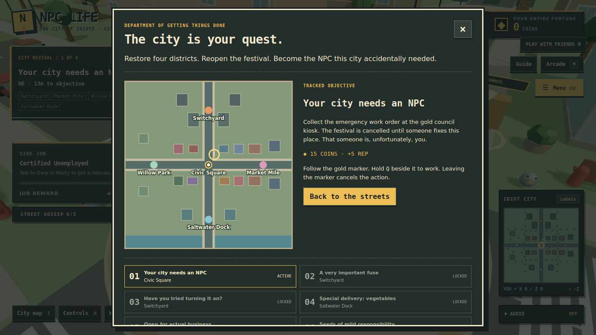
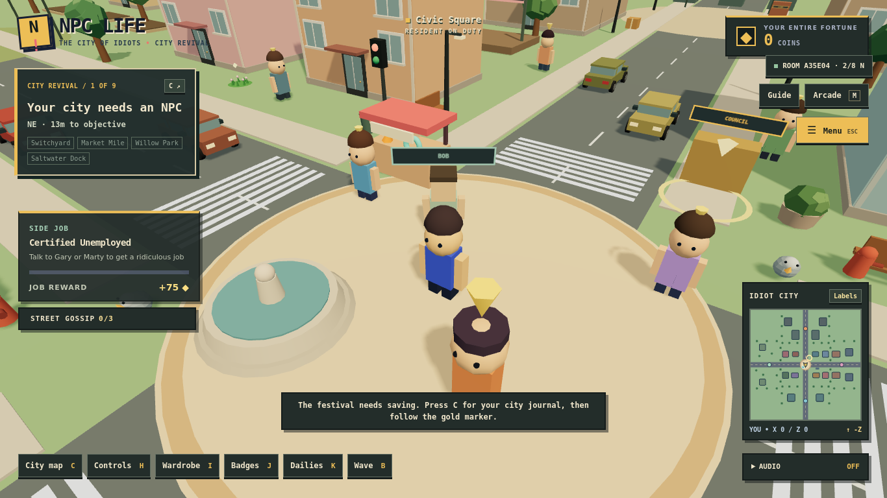

# Development contract

The current milestone is documented in [Cinematic city art](cinematic-city-art.md), built on the verified [terrain-responsive suspension](terrain-responsive-suspension.md) update. Older sections below describe historical milestones and their validation, not the current verification status.

## City Revival / multiplayer slice — 12 October 2026

The owner confirmed multiplayer as a core requirement and requested a substantial whole-game update. The new world expands the playable bounds from ±42 to ±88. Five districts and a nine-stage revival campaign give the exploration a goal; completing it unlocks rotating pickup/delivery contracts.

### Multiplayer architecture and limits

- `server/multiplayer.mjs` uses Node's HTTP server, SSE snapshots and authenticated POST movement updates. No new dependencies. Rooms have a deliberate prototype limit of eight guests and a server-wide limit of 64 rooms.
- `scripts/dev.mjs` starts Vite and the API server together; Vite proxies `/api`. `npm start` serves the built client and API from one origin.
- A session uses an unguessable bearer token. Snapshot payloads contain no tokens. Same-origin checking, bounded payloads, room capacity, join/movement rate limits, and idle expiration limit basic misuse.
- Room membership is ephemeral. EventSource reconnects across short interruptions; an expired session must rejoin. A server restart ends rooms.
- `Multiplayer.tsx` owns networking separately from dialog and camera state. Peers interpolate snapshots, show names, jump, and wave. Local menus never pause peers.
- This is a **presence relay**, not authoritative simulation: it bounds position values but does not prevent cheating through client movement. It never accepts economy/progression data. Do not describe it as competitive-ready or deploy it as a secure public game service.
- Campaign, district visuals, coins, cosmetics and saves are personal. Shared restoration and rewards require server-owned objectives, identity and persistence. No imported browser balance can become trusted shared currency.
- Next networking milestone: shared objective state with server-validated actions; cosmetic replication; accounts/reconnect identity; abuse controls and load-tested public hosting.

### World and campaign architecture

- `campaign.ts`: serializable progress, mission and district definitions, courier rotation and strict save validation.
- `CityRevival.tsx`: local mission state, proximity/hold interaction, one reward per completion, journal and HUD. Releasing Q, moving away, losing focus or opening a menu cancels the hold.
- `DistrictWorld.tsx`: district art and restoration changes; text signs use disposable local canvas textures.
- `world.ts`: shared world bounds, building footprints and prop collision. Collision flood-fill verifies that all campaign and courier targets are reachable.
- `WorldMinimap.tsx`: uses the same world bounds and objective as the journal; the gold dotted line is a direction indicator, not a pathfinding route.
- Existing save keys are preserved. `npc-life:city-revival-v1` is the only new persistent key and participates in backup/import/reset. Courier cargo is intentionally transient; deliveries persist.

## Retro municipal arcade UI

Palette: charcoal #151c1b, deep green #232d2a, warm paper #f2e8cd, mustard #edbe56, muted mint #a7d5bc. Square frames, offset shadows, city notices, inventory slots and stamped completion states establish the identity. No blurred glass surfaces or remote font requests.

- `src/game/ui/retro.css`: shared visual tokens, surface styling, HUD layout, responsive rules and reduced-motion support.
- Existing phase CSS retains component layout rules; font declarations use shared tokens. Do not add another phase-specific visual theme.
- `GameGlyph.tsx`: original grid-drawn SVG icons; no third-party art or dependencies.
- `menuStore.ts`: one active dialog per local UI instance, synchronous ownership, guarded closes.
- `GameUI.tsx`: provider and React subscriptions; menu state is transient and never written into progression.
- `GameDialog.tsx`: native dialog in the browser top layer. Makes background UI inert, contains keyboard events, cycles focus, handles Escape/backdrop close and restores focus. Native button and checkbox activation remains available.
- `App.tsx`: derives the local player lock from the shared active menu.
- `WorkDodge.tsx`: receives keys from the active dialog rather than capturing global input.

The original UI milestone preserved gameplay; City Revival now extends the world and adds a separate main campaign while retaining the original jobs and rewards.

## Regression checklist

Use a fresh test profile and a separate copied save. Never reset a real player save for QA.

1. Fresh onboarding: one dialog; WASD/Space/other menu shortcuts cannot move the player or open hidden panels. Escape skips orientation.
2. Returning player: release menu opens. Tab and Shift+Tab stay within it; Enter/Space work on buttons and settings checkboxes.
3. Open every dialog with its shortcut or interaction. Only one exists. Escape closes exactly one, without also opening the release menu.
4. Hold a movement key, open a menu, release the key, then close. No drift. Camera drag/wheel cannot operate behind a dialog.
5. Check wardrobe, shop, dailies, NPC choices, Pigeon Panic and WorkDodge. Changing tabs must not reset player progress. Minigame keys must not move the 3D character.
6. Focus returns to a clicked opening control where it still exists. Dialog content scrolls at 390×844, 768×600 and 1366×768 without horizontal overflow.
7. Toggle sound using a user gesture; verify the chime audibly on a real device. Automation can verify audio-engine state, not human audibility.
8. Reload a copied save; export/import it. Reject invalid imports without altering progress; imported equipped cosmetics must be owned.
9. Enable reduced motion and hide minimap. Verify settings persist; denied storage must not crash the release menu.
10. Verify city activity continues while a menu is open. This is local UI behavior, not proof of multiplayer networking.

## Current verification scope

Run `npm test`, `npm run build`, and `git diff --check`. Browser checks and their observed results are reported with each change. A passing production build alone does not prove gameplay, networking, audio output or deployment works.

### Optional browser regression suite

`tests/browser.mjs` starts its own Vite server on port 5181, uses an isolated browser context, exercises the actual menus and city controller, and writes captures to ignored `qa-output/`. It never uses an existing browser profile. The shop scenario seeds test coins only in that isolated context.

Playwright is optional tooling and is not added to the application dependencies:

```bash
npm install --no-save --package-lock=false playwright
npx playwright install chromium
npm run test:browser
```

A preinstalled runner can instead set `NPC_LIFE_PLAYWRIGHT_MODULE` to its Playwright module and `NPC_LIFE_CHROMIUM` to its browser executable. `NPC_LIFE_QA_OUTPUT` overrides the screenshot directory. Rendering speed under software WebGL is not a meaningful player-device performance benchmark.

## Earlier retro UI milestone verification

- 9/9 focused Node tests passed.
- 19/19 Chromium browser checks passed with no uncaught page errors in those flows.
- Production TypeScript/Vite build passed. Existing large-chunk warning remains (approximately 1.22 MB JavaScript / 343 KB gzip).
- Browser checks exercised onboarding, focus cycling/restoration after dynamic tab changes, movement lock and no stuck keys, wardrobe selection, controls and dailies shortcuts, WorkDodge input isolation, display settings, reload persistence, responsive dialog bounds, audio startup, shop purchasing, Marty quest acceptance, Pigeon Panic reward limiting, and a Dot conversation.
- Captures inspected at 1366×768, 390×844 and 768×600. Short-screen HUD overlap found during review was corrected.
- No multiplayer sessions, public deployment, full ending playthrough, real-device audio audibility or hardware performance were verified.


## Change inventory

Created:

- `src/game/ui/menuStore.ts`, `GameUI.tsx`, `GameDialog.tsx`, `GameGlyph.tsx`, `retro.css`.
- `tests/core.test.mjs`, `tests/browser.mjs`.
- `docs/development.md`, `docs/retro-ui.png`.

Updated:

- `src/main.tsx`, `src/App.tsx`: shared provider, local input lock, centralized menu ownership and new visual theme.
- `src/game/Alpha9Experience.tsx`, `ReleaseCenter.tsx`, `WorkDodge.tsx`, `ProgressionPanel.tsx`, `DailyBoard.tsx`, `PigeonPanic.tsx`, `CityEncounters.tsx`: shared dialogs and contained shortcuts.
- `src/game/AmbientSound.tsx`: compact expandable audio control.
- `src/game/releaseData.ts`: owned-equipment validation and release-menu storage resilience.
- `src/styles.css`, `phase2.css`, `phase4c.css`, `phase5.css`, `phase6.css`, `phase8.css`, `phase9.css`, `src/game/encounters.css`, `release.css`: shared font tokens, removal of obsolete backdrop rules and remote font import.
- `README.md`, `package.json`, `.gitignore`: multiplayer scope, testing commands and ignored browser captures.

The earlier UI milestone added no dependencies or save keys. City Revival adds one save key and no application dependencies.

## City Revival verification

`tests/world.test.mjs` validates campaign data, courier reward structure, map boundaries, harbor collision, and reachable objectives. `tests/multiplayer.test.mjs` starts a real HTTP server and checks room isolation, replication, token privacy, capacity, bad requests, cross-origin rejection, leaving, and expiration.

`tests/city-browser.mjs` starts Vite on 5182 and the room server on 3001. It walks the actual character through all nine missions, tests cancelled holds and exact coin totals, completes a courier contract, reloads saves, joins two independent browsers to one room, checks live waves and local input ownership, then captures responsive journals. Do not edit game source while browser suites run: Vite reloads invalidate long playthroughs.

```bash
npm run test:city
```

Both browser suites use the optional Playwright installation described above. No existing player profile is read or reset.

### Observed results for City Revival

- Production TypeScript/Vite build passes (approximately 1.25 MB JS / 351 KB gzip; existing chunk warning).
- 15 core tests pass, including the new world/campaign, camera and real HTTP multiplayer tests.
- All 19 pre-existing browser regression checks pass with no uncaught page errors.
- All nine campaign stages were completed with real keyboard movement across all five districts. The exact campaign payout is 515 coins. Releasing the work key early did not complete the first mission.
- A focused completed-campaign fixture then verified a courier pickup with no reward, delivery for 45 coins, and persistence of completed stages/delivery count through reload.
- Two independent browser contexts created/joined a real room through Vite's API proxy; movement, live waves, local menu input isolation and leaving were verified. No browser errors occurred. The proxy explicitly preserves Host so the API's same-origin check works in development.
- Journals and HUD captures were inspected at desktop, 390×844 and 768×600. A portrait minimap stretch was fixed and covered by an explicit height assertion. Market awnings now participate in camera collision; nearby shadow rendering and memoized world components limit the expanded scene's cost.
- Public internet hosting, shared progression, sustained eight-client load, real-device audio and hardware performance are not verified by these checks.

Focused browser reruns can use `NPC_CITY_START_AT=9` for the courier/persistence portion or `NPC_CITY_ONLY_NETWORK=1` for rooms and responsive UI. Defaults still run the full campaign and follow-on scenarios in a fresh profile.





## Grove & Motors — 12 October 2026

Current world bounds are ±136 (previous City Revival bounds: ±88). Grove Street is an original cul-de-sac neighborhood inspired by the requested early-3D California street aesthetic, connected to both north and west roads. Both navigation maps now include its roads and rotated building footprints.

- `shared/world.mjs` is the common source for spawn, buildings, rotated collision footprints, streets and props. `src/game/world.ts` re-exports it for existing imports.
- `Character.tsx` shares defined facial features, hair, male/female variants, hands, shoes and animated limbs across local players, peers and citizens. Citizens pause before facing nearby players rather than walking backwards.
- `GroveNeighborhood.tsx` adds homes, palms, lane markings, signage and the fountain roundabout island. The arrival spawn is on the sidewalk. Cars cannot enter the island.
- `shared/vehicles.mjs` supplies six cars, a three-circle body hull, small collision substeps, bicycle-model steering, speed-sensitive steering range, drag, reverse braking, road/off-road speed limits and safe door exits.
- `Vehicles.tsx` handles local controls, solo simulation, replicated interpolation and the speed HUD. R enters/exits; W/S accelerates/reverses; A/D steers; Space brakes. Opening a dialog clears the local driving input. Changing sessions while driving returns the player to the safe arrival point.
- The room server owns vehicle positions and occupancy, accepts controls instead of client car transforms, rejects contested/distant entry and moving/blocked exits, and releases cars when a driver leaves or times out. Pedestrian movement remains client-relayed; progression remains personal.
- Cars are an arcade driving simulation, not a full rigid-body engine: no suspension, crash deformation, passenger seats or vehicle/pedestrian knockback. Vehicle state is transient and resets with the solo page/room lifecycle. No new dependency or persistent save key.

### Verification for this update

- 20 Node tests pass, including existing saves/menu tests, campaign and courier reachability from the new spawn, Grove access, car parking/exits, braking/reverse, frame-rate consistency, anti-tunnelling hull collision, and a real HTTP multiplayer ownership/driving/disconnect test.
- TypeScript and production build pass; the existing large-bundle warning remains.
- `git diff --check` passes.
- Browser regression launch was attempted with the installed Chromium but stopped by the environment (`socket() failed: Operation not permitted`). No fresh browser gameplay, two-browser driving, screenshots, mobile visual review, audible audio or hardware performance claims are made for this update. Earlier verification sections and screenshots describe earlier commits.
- The city browser test driver now plans collision-aware routes around the fountain and parked cars. Run `npm run test:browser` and `npm run test:city` on a machine with Playwright/Chromium available.

Manual follow-up: walk from arrivals to the sedan east of Gary, enter with R, accelerate/steer/brake, stop and exit; repeat in a shared room with a second browser, verify exclusive ownership and remote car motion, open a menu while driving, leave while seated, tour Grove and check character/prop appearance.

## Living City & Survival verification

The Living City update extends the advanced career source. See `docs/living-city-survival-weather.md` for controls, compatibility, tuning and intentional limitations. The current update was exercised in Chromium using software WebGL; prior sections above describe older commits and their browser constraints.

`npm ci`, 43 Node regression tests, TypeScript, the production build and whitespace checks pass. Existing UI/encounter checks (19), resident/driving checks (9), and new living-city browser checks (14) pass. New fixtures cover all six weather states, nighttime rendering, exact purchase/consume counts, zero-coin recovery, new shifts, samples, phone/laptop panels and real save import/reload. Captured audio initialization does not establish speaker audibility or hardware performance.

## City Mobility & Visual Foundation milestone

Built from the delivered Living City commit. The shared vehicle catalog, collision-aware collection, new fixed-step controllers and original procedural art are documented in `docs/city-mobility-visual-foundation.md`.

Run `npm run test:mobility` with the existing external Playwright/Chromium environment variables. The fixtures exercise legitimate garage purchases, single-debit handling, persistence/finishes, scooter driving, car entry/exit, jumps/landing, six additional premium/utility/motorcycle silhouettes, responsive panels and two-browser public motorcycle driving. Owned-vehicle render fixtures are test-only.

The UI browser driver now uses shorter input samples near waypoints so that it can converge under the new momentum controller; assertions and real movement remain in place. Personal collection is intentionally not accepted from local-save unlocks in shared rooms. Full 3D rigid-body physics and the final city art target remain further milestones.
