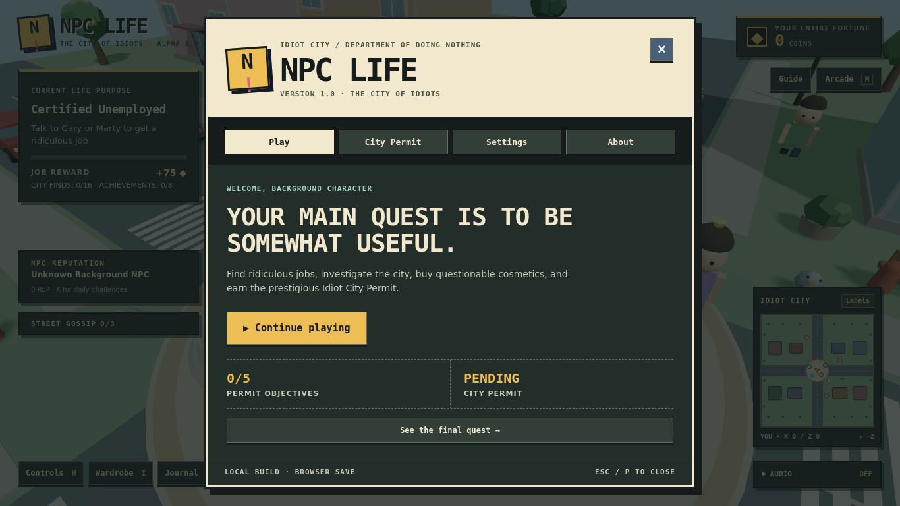

# Development contract

## Product correction — 12 October 2026

The owner confirmed NPC LIFE is a **multiplayer game**. This supersedes the earlier handoff's single-player scope and the starter README's deferred multiplayer roadmap.

The audited repository has no multiplayer transport, server, room discovery, remote-player replication or shared persistence. This UI milestone does not claim to add them. Shared sessions are the next core development milestone, before public multiplayer release.

### Multiplayer requirements to carry forward

- Menus, settings, focus and input locks are client-local; never broadcast a menu as a global pause.
- Continue rendering world activity while a local menu is open. Decide explicitly whether a player using a minigame remains vulnerable/interactive in the shared city.
- Put networking behind a separate session layer. Keep camera control, dialog state and display settings client-local.
- Next vertical slice: two browser clients join one room, see each other's movement/cosmetics/emotes, and handle disconnect/reconnect without duplicate avatars.
- Use server authority for shared rewards, balances and contested objectives. Do not trust imported localStorage balances or the client clock for multiplayer rewards.
- Preserve existing browser saves as local progression. Any migration into multiplayer identities needs an explicit, tested policy.
- Public-room capacity, guest identity, shared versus per-player quests, and hosting are unresolved architecture decisions. Do not invent a player limit, promise unlimited free hosting, or add a paid service.
- Verify with two independent browser contexts and an actual session server. Two tabs running isolated local games do not constitute multiplayer.

## Retro municipal arcade UI

Palette: charcoal #151c1b, deep green #232d2a, warm paper #f2e8cd, mustard #edbe56, muted mint #a7d5bc. Square frames, offset shadows, city notices, inventory slots and stamped completion states establish the identity. No blurred glass surfaces or remote font requests.

- `src/game/ui/retro.css`: shared visual tokens, surface styling, HUD layout, responsive rules and reduced-motion support.
- Existing phase CSS retains component layout rules; font declarations use shared tokens. Do not add another phase-specific visual theme.
- `GameGlyph.tsx`: original grid-drawn SVG icons; no third-party art or dependencies.
- `menuStore.ts`: one active dialog per local UI instance, synchronous ownership, guarded closes.
- `GameUI.tsx`: provider and React subscriptions; menu state is transient and never written into progression.
- `GameDialog.tsx`: native dialog in the browser top layer. Makes background UI inert, contains keyboard events, cycles focus, handles Escape/backdrop close and restores focus. Native button and checkbox activation remains available.
- `App.tsx`: derives the local player lock from the shared active menu.
- `WorkDodge.tsx`: receives keys from the active dialog rather than capturing global input.

The world visuals, quest rewards, local save keys and scene simulation are preserved. The interface pass is not a photorealistic asset overhaul.

## Regression checklist

Use a fresh test profile and a separate copied save. Never reset a real player save for QA.

1. Fresh onboarding: one dialog; WASD/Space/other menu shortcuts cannot move the player or open hidden panels. Escape skips orientation.
2. Returning player: release menu opens. Tab and Shift+Tab stay within it; Enter/Space work on buttons and settings checkboxes.
3. Open every dialog with its shortcut or interaction. Only one exists. Escape closes exactly one, without also opening the release menu.
4. Hold a movement key, open a menu, release the key, then close. No drift. Camera drag/wheel cannot operate behind a dialog.
5. Check wardrobe, shop, dailies, NPC choices, Pigeon Panic and WorkDodge. Changing tabs must not reset player progress. Minigame keys must not move the 3D character.
6. Focus returns to a clicked opening control where it still exists. Dialog content scrolls at 390×844, 768×600 and 1366×768 without horizontal overflow.
7. Toggle sound using a user gesture; verify the chime audibly on a real device. Automation can verify audio-engine state, not human audibility.
8. Reload a copied save; export/import it. Reject invalid imports without altering progress; imported equipped cosmetics must be owned.
9. Enable reduced motion and hide minimap. Verify settings persist; denied storage must not crash the release menu.
10. Verify city activity continues while a menu is open. This is local UI behavior, not proof of multiplayer networking.

## Current verification scope

Run `npm test`, `npm run build`, and `git diff --check`. Browser checks and their observed results are reported with each change. A passing production build alone does not prove gameplay, networking, audio output or deployment works.

### Optional browser regression suite

`tests/browser.mjs` starts its own Vite server on port 5181, uses an isolated browser context, exercises the actual menus and city controller, and writes captures to ignored `qa-output/`. It never uses an existing browser profile. The shop scenario seeds test coins only in that isolated context.

Playwright is optional tooling and is not added to the application dependencies:

```bash
npm install --no-save --package-lock=false playwright
npx playwright install chromium
npm run test:browser
```

A preinstalled runner can instead set `NPC_LIFE_PLAYWRIGHT_MODULE` to its Playwright module and `NPC_LIFE_CHROMIUM` to its browser executable. `NPC_LIFE_QA_OUTPUT` overrides the screenshot directory. Rendering speed under software WebGL is not a meaningful player-device performance benchmark.

## Verified in this workspace

- 9/9 focused Node tests passed.
- 19/19 Chromium browser checks passed with no uncaught page errors in those flows.
- Production TypeScript/Vite build passed. Existing large-chunk warning remains (approximately 1.22 MB JavaScript / 343 KB gzip).
- Browser checks exercised onboarding, focus cycling/restoration after dynamic tab changes, movement lock and no stuck keys, wardrobe selection, controls and dailies shortcuts, WorkDodge input isolation, display settings, reload persistence, responsive dialog bounds, audio startup, shop purchasing, Marty quest acceptance, Pigeon Panic reward limiting, and a Dot conversation.
- Captures inspected at 1366×768, 390×844 and 768×600. Short-screen HUD overlap found during review was corrected.
- No multiplayer sessions, public deployment, full ending playthrough, real-device audio audibility or hardware performance were verified.



## Change inventory

Created:

- `src/game/ui/menuStore.ts`, `GameUI.tsx`, `GameDialog.tsx`, `GameGlyph.tsx`, `retro.css`.
- `tests/core.test.mjs`, `tests/browser.mjs`.
- `docs/development.md`, `docs/retro-ui.png`.

Updated:

- `src/main.tsx`, `src/App.tsx`: shared provider, local input lock, centralized menu ownership and new visual theme.
- `src/game/Alpha9Experience.tsx`, `ReleaseCenter.tsx`, `WorkDodge.tsx`, `ProgressionPanel.tsx`, `DailyBoard.tsx`, `PigeonPanic.tsx`, `CityEncounters.tsx`: shared dialogs and contained shortcuts.
- `src/game/AmbientSound.tsx`: compact expandable audio control.
- `src/game/releaseData.ts`: owned-equipment validation and release-menu storage resilience.
- `src/styles.css`, `phase2.css`, `phase4c.css`, `phase5.css`, `phase6.css`, `phase8.css`, `phase9.css`, `src/game/encounters.css`, `release.css`: shared font tokens, removal of obsolete backdrop rules and remote font import.
- `README.md`, `package.json`, `.gitignore`: multiplayer scope, testing commands and ignored browser captures.

No application dependencies or save keys were added or renamed.
