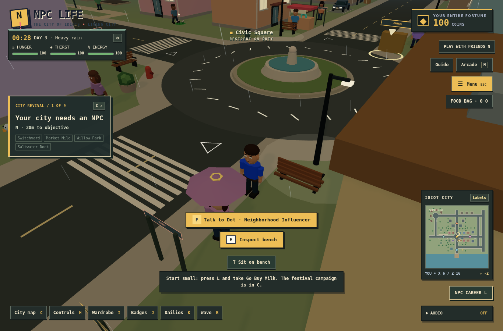
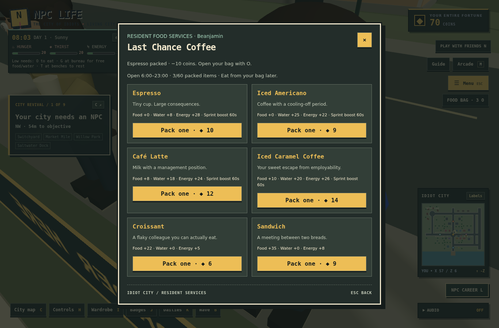

# NPC LIFE — Living City & Survival

## Source and compatibility

Base: `feat/npc-career-and-city-bulletin` at `7f304838cc9618bdc1802078f316e40d700a314a`.

The other remote branches were inspected. `develop` is an ancestor of the advanced gameplay source. `feat/m1a-world-config-validation` is an older parallel branch from `main`, with its older world layout; applying it wholesale would remove the newer city foundation. Its branch remains untouched. This update uses the advanced shared collision map and its existing placement tests. No branch was deleted, force-pushed, or merged into main.

## Play a normal day

1. Check the time, weather, food, water and energy at the top left.
2. Visit Last Chance Coffee at Market Mile (57, 6), the Unemployed Diner (36, 6), the convenience store (24, −6), or Dockside Dogs & Skewers (25, 58).
3. Press **G** by a service counter, choose an item, and pack it into your bag. **T** still opens the existing café service. Park and exit vehicles before ordering.
4. Press **O** to consume food and drinks later. **I** still opens cosmetics; **F** still talks to street residents.
5. Press **L** for career, bulletin, upgrades, and work. Coffee delivery, food courier, rainy delivery, storm cleanup, morning papers and Coffee Shop Employee use the existing reputation and shift progression.
6. At the café during an employee shift, press **T**, read three customer tickets, and prepare the right drinks. Two mistakes or 45 seconds ends the mini-game without a fine.
7. **T** at benches restores energy. **G** at the Civic Square bureau (6, 22) gives an immediate free meal and tap water when hunger or thirst is below 45. It does not mint coins or add stockpilable free inventory.
8. The gear button beside the clock opens relaxed needs and low/medium/high weather quality.

## Systems and tuning

- One item registry: 19 products, quantities, categories, prices, descriptions, restoration and timed caffeine boosts. Bag capacity is 60 units. Purchases validate location, product, opening hours, exact balance and capacity; synchronous refs prevent stale React snapshots from duplicating inventory or spending below zero.
- Idle hunger drops about 0.84/minute, walking about 1.26/minute. Thirst drops 1.08/minute idle, 1.8/minute walking; sunny midday raises thirst cost 30%. Working adds a small drain and successful shift actions cost two energy and one hunger. No starvation damage, death or permanent movement lock.
- Low hunger or thirst reduces idle energy recovery. Energy recovers while idle and much faster on benches; continuous sprinting costs energy. Low energy reduces sprint speed but preserves walking. Food also restores energy. Relaxed mode reduces depletion/activity costs by 65%.
- Needs pause in all owned dialogs and hidden tabs. World time keeps going through ordinary menus; local onboarding and hidden tabs suspend the solo clock. There is no offline depletion. The shared room clock continues independently.
- A centralized clock advances one game minute per real second: a full day is 24 minutes. Weather lasts five minutes and blends across 20 seconds. Sunny, cloudy, light rain, heavy rain, thunderstorms and fog share the same deterministic model on server and client.
- Weather changes sky, fog, sun, rain intensity, road roughness, puddles and ambience. Night changes lighting, window/shop/streetlamp emission, vehicle headlight emission and inexpensive lamp pools. Ambient light keeps nighttime navigation possible.
- Rain uses one bounded line-segment buffer around the camera: 100/300/600 drops for low/medium/high. No postprocessing, reflection capture, paid weather API or new runtime dependencies. Low quality disables sun shadows and limits DPR.
- Thunderstorms produce occasional light flashes and procedural thunder. Reduced motion suppresses flashes. All audio uses the existing master, SFX and ambience channels and requires a user gesture. Audio was exercised in Chromium; audible quality still needs real speakers/headphones.
- New market residents have staggered coffee, lunch, stroll, shelter and night-idle routines; existing named residents retain their encounters/routes, use umbrellas and settle at night. All movement checks the shared static collision map.
- Timed city events offer a real café discount, one dockside hotdog sample per event, or a Civic feast which raises emergency meal recovery to 75 food and water. Events do not open dialogs or interrupt active shifts. Sample claims survive reload.
- Weather/time checks gate job acceptance. Accepted deliveries remain completable after weather clears or shops close. New work increments the existing career, bulletin, job-type and bag-upgrade rewards.

## Persistence and multiplayer

The optional `npc-life:living-city-v1` record stores needs, consumables, preferences, solo time, seed, caffeine time and sample cooldown. Existing save keys are preserved. Missing new data defaults safely; invalid imported quantities, needs or timings are rejected before any save replacement. Existing import rollback remains intact.

Export flushes the live needs snapshot before building the backup. Successful import/reset tells the runtime to stop writing its old snapshot during reload, preventing stale state from replacing imported progress.

Room snapshots include server elapsed time and seed. Clients interpolate from each received snapshot. Wet-road braking/speed limits run through the same server/solo integrator. The existing server continues to reject client progression: wallets, consumables, jobs and rewards are personal local-save features, not multiplayer-authoritative transactions. This update does not add a pretend authoritative economy.

## QA and practical limits

Run:

```sh
npm ci
npm test
npm run build
```

Optional Chromium/Playwright regression suites (browser tooling stays outside production dependencies):

```sh
npm run test:browser
npm run test:foundation
npm run test:city
npm run test:living
```

If using externally installed tooling, set `NPC_LIFE_PLAYWRIGHT_MODULE` and `NPC_LIFE_CHROMIUM` as described in `docs/development.md`. Browser captures go to the ignored `qa-output/` directory. Tests disable HMR for repeatable runs.

The new targeted checks cover needs/rates/pause, exact transactions, single consumption, bounded samples, malformed imports, room clock synchronization, opening hours, job eligibility, continued delivery after weather changes, kiosk collisions and access. Existing route tests verify every campaign and resident-job stop is reachable from spawn.

This is an incremental procedural city update. Businesses are distinct exterior service kiosks, not enterable interiors. NPC schedules are local market routines and weather responses, not citywide commuting or autonomous economies. Vehicle effects are subtle traction changes and headlight emission, not windshield/splash simulation. Power outages, full NPC transit/seating systems and dynamic storm debris rendering remain future work. Touch panels/buttons work; the existing movement controller still primarily targets keyboard/mouse. No mobile-device performance claim is made.

The production build retains Vite's large-bundle warning for the existing React/Three.js application. Hardware FPS, real-device touch input and audible mix quality require device testing.

## Gameplay captures




