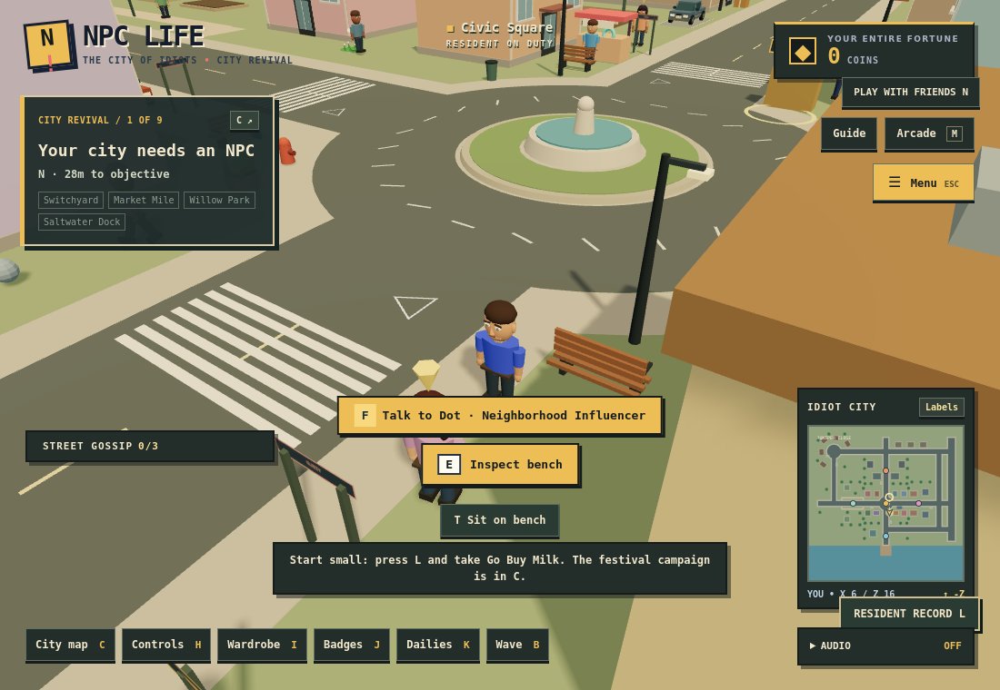
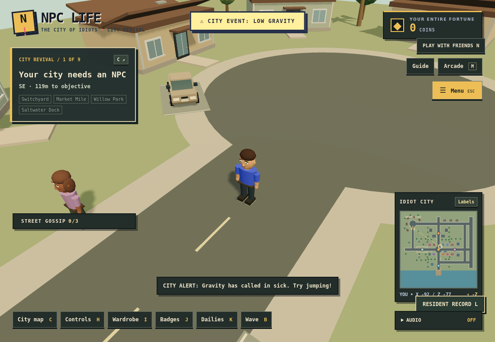

# NPC LIFE — World rebuild and gameplay foundation

This milestone extends the working Grove & Motors source (`c011e57`). It is not a claim that every item in the long-term finishing brief is complete. Existing festival missions, personal saves, shop, wardrobe, dailies, minigames and guest rooms remain in place.

## Audit and fixes

The baseline is React 19, React Three Fiber 9 and Three.js with generated geometry; Vite/TypeScript build the client. The Node HTTP/SSE room server owns shared car simulation and occupancy. Player movement, camera, pedestrian rendering and most progress are client-local. Web Audio generates the existing sound effects. No paid services or application dependencies were added.

The baseline build and 20 tests passed. The audit identified these concrete issues:

- District ground circles painted over asphalt; independent geometry/map/road predicates had drifted apart.
- Transformers stood across the north avenue. Some new interaction coordinates were obstructed by street furniture.
- Tree checks did not cover all intended recreation space or common placement constraints.
- The old traffic module was unmounted, with obsolete back-and-forth routes; it has been removed.
- Citizen interaction distances used spawn points instead of their live positions; ambient walkers could ignore static obstacles.
- The screen retained an obsolete hidden map and an idle side-job card.
- Driving had no engine sound and forced the camera heading every frame.

## Planned city

`shared/cityPlan.mjs` defines avenues, local streets, collectors, an eastern bypass, round roads, park paths, parking bays and service sites. `CityInfrastructure` renders it and `CityMapLayer` uses the same coordinates in every map. Building and canopy placement uses reusable footprint, road-clearance and occupancy checks. Rejected candidates are never rendered or used as colliders. Named mission landmarks keep their original campaign identity.

- Civic district: sidewalk arrivals, resident bureau, fountain traffic island and marked crossings.
- Juniper Close: original residential cul-de-sac, Motor Club, parking and recreation court. This replaces the previous Grove label rather than reproducing a GTA location.
- Switchyard: relocated transformer bank, north collector and dispatch work.
- Market Mile: stalls, coffee service and taxi destination.
- Willow Park: clear walking paths and a repeatable litter route.
- Saltwater Dock: existing shore, pier and campaign with delivery work.
- East collectors/bypass: a connected road circuit with shared traffic; buildings are excluded from the road and sidewalk footprint.

The road hierarchy is explicit; the traffic prototype currently follows one rounded eastern circuit rather than navigating every intersection. Circulating fountain lanes are available to players, but autonomous traffic does not yet route through that roundabout.

## Play loop

Press **L** for the resident record and choose **Go Buy Milk**. Travel to the shop, press **T** to pick up, return to the bureau, then press **T** to deliver. Pickup never pays. Finishing pays coins and reputation. Repeat work or explore other districts; buy unlocks and cosmetics and continue the separate festival campaign with **C / hold Q**.

| Shift | Activity | Base payout | Access |
| --- | --- | --- | --- |
| Go Buy Milk | Collect and return a carton | 25 coins / 8 REP | Available immediately |
| Parks & Mild Recreation | Collect three bags and recycle | 45 coins / 12 REP | Available immediately |
| Definitely Legal Delivery | Dispatch-to-dock delivery in 180 seconds | 65 coins / 18 REP | 25 REP |
| Five-Star Background Driver | Pick up and drop off while stopped in a car | 80 coins / 20 REP | 40 REP + Motor Club licence |

The licence costs 75 coins. A 90-coin courier bag adds 10 coins to milk/courier jobs. A 45-coin guide reveals a hidden survey marker. Purchases happen at the bureau or Motor Club. Timed jobs continue while menus are open; failure or abandonment carries no money penalty. An active shift is transient and must be accepted again after reloading. This avoids a partially loaded paid delivery.

Other activities: **T** at the seven civic/park/harbor benches to sit (move or T to stand), **T** at Market Mile coffee for a 10-coin 60-second sprint boost, **T** at the civic shuttle for free travel to Juniper, and **T** at Juniper Court for a five-shot timing game. Three baskets pay 12 coins and 4 REP. Five resident achievements record shifts, benches, court wins and the secret.

## Simulation and performance

- Three traffic cars use a rounded, right-hand lane circuit with hull checks and pedestrian lookahead. Server and solo share the same code. Occupied traffic cars cannot be taken; the six parked cars remain usable.
- Parked vehicles skip stationary integration. Existing collision substeps, braking/reverse, safe exits and exclusive room ownership remain.
- Deciduous trees use two instanced meshes instead of individual trunk/canopy meshes. Characters are memoized; distant pedestrian animation pauses beyond 65 meters. This reduces work, but is not a hardware FPS measurement.
- Special citizen proximity reads live positions. Ambient walkers turn toward nearby players while stopped, relax their stride, and check obstacles before walking. Four additional walkers populate Juniper, the park, dispatch and the market; their patrol segments were checked against road and collision geometry.
- Driving camera returns gradually behind a moving car and allows mouse orbit. Footsteps, engine, horn (**V**) and impact cues use the existing user-enabled Web Audio context. Master, SFX and ambience have separate sliders. There is no music track in this milestone, so no nonfunctional music slider is presented.
- Resident menu, court dialog and existing screens share the focus-trapping dialog/input system. Menus only lock the local player. An active resident shift uses the primary HUD objective slot; the festival journal remains accessible with C. Service maps show the player and accepted shift.

## Saves and multiplayer boundaries

`npc-life:resident-life-v1` is validated and included in existing export/import/reset. It stores completed shifts, purchased unlocks, bench visits, court wins and the secret. Old saves do not require this key. Coins and reputation still use the existing keys. Audio channel slider positions are session preferences in this milestone.

Rooms share players, vehicles and traffic. New jobs, rewards, coffee effects, achievements, district restoration and minigames remain personal. Browser balances are not authoritative multiplayer money. NPCs are lightweight local ambient characters rather than a synchronized city population.

## Run and verify

```bash
npm run dev:multi
npm test
npm run typecheck
npm run build
npm run test:browser
npm run test:foundation
npm run test:city
```

Browser suites require optional Playwright and Chromium. Existing environment overrides `NPC_LIFE_PLAYWRIGHT_MODULE`, `NPC_LIFE_CHROMIUM` and `NPC_LIFE_QA_OUTPUT` are supported. The foundation browser suite uses isolated seeded profiles and the production relocation event for individual service/shift fixtures; this is not represented as a complete manual walk across the city. The original browser suite exercises actual walking, and the city suite covers the campaign and two-browser rooms.

### Observed verification — 12 October 2026

- **26/26 Node tests pass:** placement, all old/new objective reachability, job stages/access/timers, rewards, save validation/rollback, menu ownership, car physics, room isolation and authoritative vehicle occupancy.
- **19/19 existing Chromium checks pass:** real walking to the shop, Marty and arcade; purchases, old quests, NPC conversations, minigames, audio startup, focus/input handling, persistence and responsive menus.
- **9/9 foundation Chromium checks pass:** milk delivery without duplicate payouts, exact upgrade cost, driving/menu braking/exit, civic and park benches, shuttle, court payout, reload persistence and phone/laptop layouts. The accepted shift replaces the campaign HUD card and clears the phone minimap.
- **Two-browser room regression passes:** independent profiles create/join a real room, transmit waves, keep menu locking local, and disconnect cleanly. Responsive city journals pass. The software renderer needed an explicit wait for the guest's first player frame before clicking onboarding.
- **TypeScript, production build and `git diff --check` pass.** No lint script is configured. The existing large-chunk warning remains: approximately 1.28 MB JavaScript / 364 KB gzip.
- **Visual review:** inspected rendered samples from Civic Square, Juniper Close, the court, Switchyard, Market Mile, Willow Park, the harbor and the eastern bypass. Corrected floating service signs, narrow-screen controls, overlapping interaction messages and the court interaction range. This was a fixture-based visual tour, not a continuous manual walk.
- New progression is included in validated import/export/reset; old saves remain valid. Browser flows reported no uncaught page errors.

The full nine-mission keyboard playthrough was not repeated in this milestone; objective reachability and campaign state/rewards are covered by automated tests, and the unchanged campaign's earlier playthrough is recorded in `development.md`. Browser fixture relocation and screenshots do not constitute a complete manual city walkthrough.

### Remaining scope

Hardware performance, real-device audibility, public hosting and sustained eight-client load are unverified. Traffic currently uses one eastern circuit; it does not navigate all city junctions. Vehicles retain the existing arcade collision model without suspension, deformation or passenger models. The shuttle is a direct transfer, not a simulated bus route. Active shifts are transient, and new progression remains personal in shared rooms. Audio channel settings reset with a new session.

The next substantial additions are a modular world-event catalog extending the existing duck/low-gravity events, richer NPC schedules/reactions, full-city traffic routing, day/night presentation and shared multiplayer objectives. This is a completed foundation milestone, not the entire finishing vision.

### Git handoff

The milestone branch is `feat/world-foundation`, based on the published `feat/retro-game-ui` source at `c011e57`. Publishing the branch does not deploy a public game server. To run this branch locally:

```bash
git fetch origin
git switch feat/world-foundation
npm ci
npm run dev:multi
```

## Captures from this milestone




